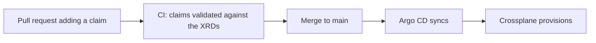

# IdPlatformKit instances

**The claims of [IdPlatformKit](https://github.com/idPlatformKit)**: every `Tenant` and `PostgresDatabase` that should exist on the platform, declared in Git.

Argo CD syncs this repository onto the cluster, and the Crossplane compositions from [Orchestrator](https://github.com/idPlatformKit/Orchestrator) turn each claim into real resources. Changing the platform means opening a pull request here, never running `kubectl apply`.



## Layout

```
tenants/<tenant>.yaml                   # cluster-scoped: one per team
databases/<namespace>/<name>.yaml       # namespaced: lives in the tenant's namespace
```

| Kind | API | Docs |
|---|---|---|
| `Tenant` | `platform.idplatformkit.io/v1alpha1` | [tenant.md](https://github.com/idPlatformKit/Orchestrator/blob/main/docs/compositions/tenant.md) |
| `PostgresDatabase` | `database.idplatformkit.io/v1alpha1` | [postgres-database.md](https://github.com/idPlatformKit/Orchestrator/blob/main/docs/compositions/postgres-database.md) |

## Adding a claim

1. Add a file following the layout above. `tenants/checkout.yaml` and `databases/checkout/checkout-db.yaml` are working examples.
2. Open a pull request. CI validates every claim against the Orchestrator XRDs with `crossplane resource validate`. A misspelled kind, a wrong type, a missing required field or an unknown field fails the check.
3. Once merged, Argo CD applies it within a few minutes.

To check a change locally (requires the [Crossplane CLI](https://docs.crossplane.io/latest/cli/) and an Orchestrator checkout next to this one):

```sh
crossplane resource validate --error-on-missing-schemas ../Orchestrator/compositions/ tenants/,databases/
```

## Deleting is real

Argo CD syncs this repository with `prune` enabled. **Removing a file deletes the resource**: removing a `Tenant` deletes its namespace and everything in it, including its OpenBao namespace and secrets. Removing a `PostgresDatabase` drops the database. Review deletions accordingly.

## Status

Part of the GitOps flow described in [Orchestrator's docs/gitops.md](https://github.com/idPlatformKit/Orchestrator/blob/main/docs/gitops.md). The backing services are dev-mode, single-replica with fixed credentials: this is a reference implementation, not production.

## License

[Apache 2.0](LICENSE)
